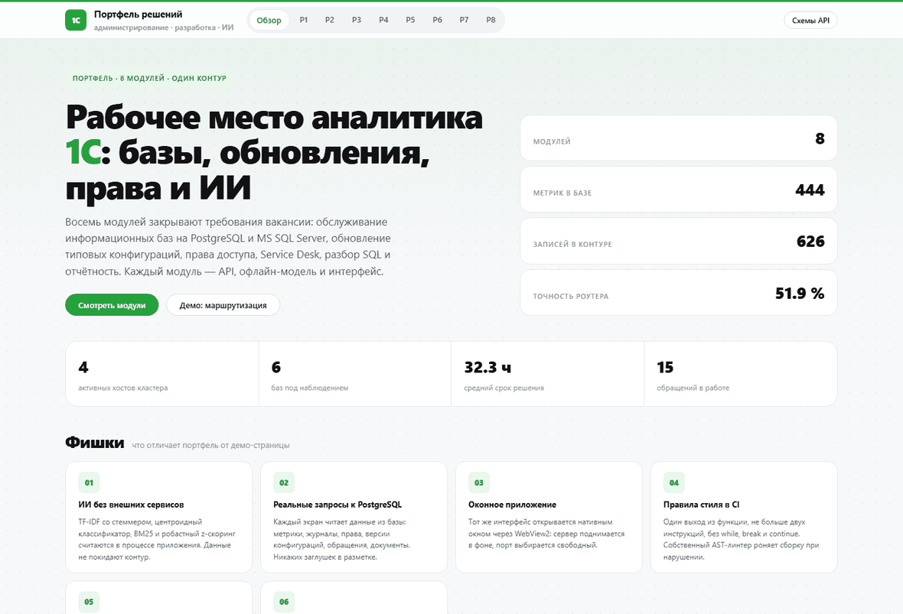
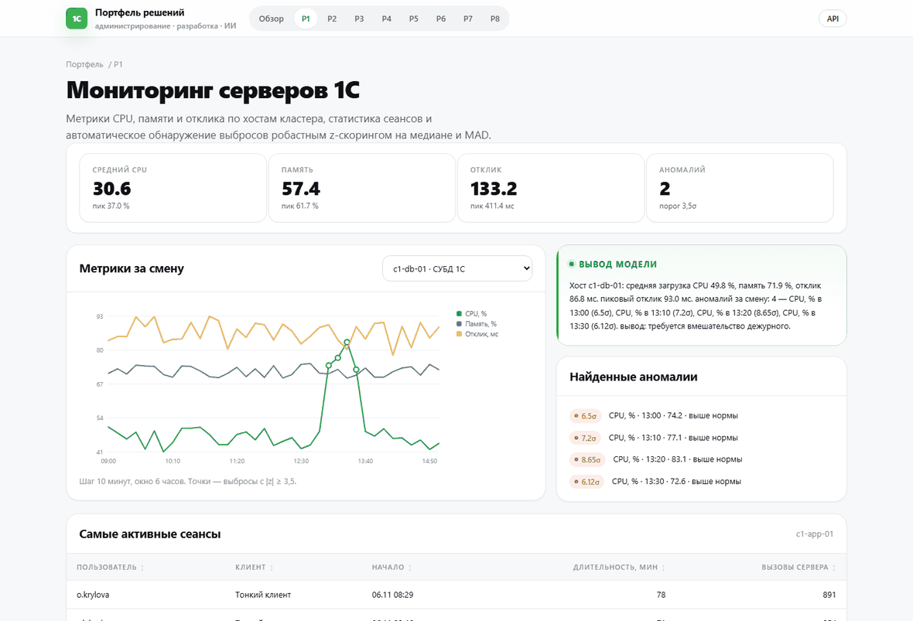

# Портфель решений для 1С: бэкенд, ИИ и фронтенд

Восемь рабочих модулей по мотивам вакансии «Программист 1С»: администрирование информационных баз
на PostgreSQL и MS SQL Server, обновление типовых конфигураций, права доступа, Service Desk,
SQL-разбор запросов, XBRL-отчётность и документооборот.

Стек: Python 3, FastAPI, PostgreSQL 16, Jinja2, ES-модули без сборщика, офлайн-модели (TF-IDF,
центроидный классификатор, BM25, робастный z-скоринг). Внешние сервисы не нужны, данные не покидают контур.



Живые действия — маршрутизация обращения, разбор SQL, классификация документов:



## Оконное приложение для аналитика

Веб-версия запускается в нативном окне: сервер поднимается в фоновом потоке, интерфейс открывается
через WebView2 (pywebview), порт выбирается свободный.

```powershell
$env:PYTHONUTF8=1
python -m app.desktop          # окно 1460×940, заголовок «рабочее место аналитика»
```

Если pywebview недоступен, то же окно открывается режимом `--app` локального Chrome или Edge.
Порт можно зафиксировать: `$env:DESKTOP_PORT=8020`.

## Что это на самом деле

Интерфейс стилизован под Сбер (зелёный `#21A038`, графит, радиусы 20px), но приложение — **бэкенд**,
который действительно работает, а не картинка:

| Модуль | Что реально делает |
|--------|--------------------|
| P1 Мониторинг | читает 444 метрики из PostgreSQL, считает средние и пики, находит выбросы по медиане и MAD |
| P2 Бэкапы | считает статусы и RPO по шести базам, разбирает записи журнала и определяет причину сбоя |
| P3 Права | строит матрицу «пользователь — роль — объект», находит уволенных с доступом и админов вне ИТ |
| P4 Обновления | сравнивает составы объектов двух версий конфигурации, считает риск и собирает чек-лист |
| P5 SQL | разбирает запрос и план по 10 правилам, снимает оценку и предлагает `create index` |
| P6 Service Desk | маршрутизирует обращение по 9 группам, ставит приоритет и SLA, подбирает статью BM25 |
| P7 XBRL | парсит XML, вытаскивает факты, проверяет баланс `активы = обязательства + капитал` |
| P8 Документы | определяет тип документа, тянет реквизиты, проверяет контрольные числа ИНН, ищет дубли |

Всё это — HTTP-API (см. `/docs`), страницы лишь показывают результат вызовов. Метрика маршрутизации
P6 (51,9 % leave-one-out на 54 размеченных примерах) считается на лету и честно выводится на экран,
а не вписана в документацию.

## Запуск

```powershell
# 1. PostgreSQL 16: служба postgresql-x64-16 на порту 5432, база sber_portfolio
#    (схема создаётся миграцией при старте приложения, данные — идемпотентным наполнением)
$env:PGPASSWORD="postgres"; & "C:\Program Files\PostgreSQL\16\bin\createdb.exe" -h 127.0.0.1 -p 5432 -U postgres sber_portfolio

# 2. Приложение
$env:PYTHONUTF8=1
python -m uvicorn app.main:app --host 127.0.0.1 --port 8010
```

Интерфейс: http://127.0.0.1:8010 · OpenAPI: http://127.0.0.1:8010/docs

Пересобрать гифки после изменения интерфейса (Playwright + локальный Chrome через CDP-порт):

```powershell
python tools/make_gif.py       # demo.gif — 9 страниц, interactions.gif — 5 действий
```

Скриншоты кладутся в `docs/shots/`, гифки собираются Pillow: 1180 px по ширине, 128 цветов,
1,5 с на кадр.

## Проверки

```powershell
python tools/style_lint.py          # правила ST001-ST004 по app/ tools/ tests/ static/
python -m ruff check .              # линтер проекта, конфиг ruff.toml
python -m pytest -q                 # 27 тестов: страницы, API, модели, стиль
```

## Правила стиля кода (проверяются автоматически)

| Код | Правило |
|-----|---------|
| ST001 | один выход из функции: `return` и `while` считаются выходом, второй выход — нарушение |
| ST002 | тело функции — не больше двух инструкций |
| ST003 | запрещены `while`, `break`, `continue` |
| ST004 | те же запреты для статических JS-модулей |

Стиль выдержан во всём коде: логика раскладывается на короткие именованные функции,
вместо циклов с `break` используются включения, фильтры и рекурсивный обход дерева.
`tools/style_lint.py` — собственный AST-линтер, нарушение роняет тест `tests/test_style.py`.

## Проекты

| Код | Модуль | Бэкенд | ИИ | Фронтенд |
|-----|--------|--------|----|----------|
| P1 | Мониторинг серверов 1С | метрики CPU/память/отклик, сеансы, агрегаты | робастный z-скоринг (медиана + MAD) | SVG-график, переключение хоста |
| P2 | Резервное копирование | задания, журналы, контроль RPO | центроидный классификатор причин сбоя на TF-IDF | разбор журнала по кнопке |
| P3 | Аудит прав доступа | пользователи, роли, матрица прав | скоринг риска по шести правилам | рейтинг риска, пересчёт |
| P4 | Обновления конфигураций | версии и состав объектов | diff-анализ и веса риска по типам объектов | сравнение версий на лету |
| P5 | SQL-аналитик MSSQL/PostgreSQL | образцы запросов и планов | 10 правил разбора плана и запроса, подсказка индекса | разбор своего запроса |
| P6 | Service Desk | очередь, SLA, база знаний | маршрутизация (centroid), BM25-подбор статьи, черновик ответа | форма обращения |
| P7 | XBRL/XML отчётность | отчёты, факты | разбор XML, арифметика баланса, проверка периода | валидация отчёта |
| P8 | Документооборот | входящие документы | классификация типа, реквизиты, контроль ИНН, поиск дублей | переклассификация |

### Что считается «ИИ» здесь

- **TF-IDF + центроидный классификатор** — маршрутизация обращений (P6) и типы документов (P8),
  обучение на размеченных примерах внутри кода, метрика — leave-one-out точность.
- **BM25** — поиск статьи базы знаний под текст обращения (P6).
- **Робастный z-скоринг** на медиане и MAD — выбросы метрик (P1), устойчив к «тяжёлым хвостам».
- **Правила + скоринг** — риск обновления (P4), риск прав доступа (P3), анализ SQL (P5).
- **NLG на шаблонах** — человекочитаемые сводки вместо «сырых» JSON.

Всё считается локально, без обращений к внешним API. Точность маршрутизации отображается на лендинге
и пересчитывается leave-one-out по размеченному набору.

## Структура

```
app/
  main.py              сборка приложения, миграция, наполнение, лендинг
  desktop.py           оконное приложение: uvicorn в потоке + WebView2
  catalog.py           карточки портфеля и навигация
  core/
    config.py          настройки, DSN
    db.py              свой пул соединений psycopg, без ORM
    ui.py              Jinja2, фильтры форматирования
    seed.py            детерминированные демо-данные (random.Random(20261106))
    ai/
      text.py          токенизация, TF-IDF, косинус
      classify.py      центроидный классификатор
      bm25.py          ранжирование статей
      anomaly.py       медиана, MAD, робастный z
      narrative.py     склонения и сборка сводок
  projects/p1..p8/     service.py (логика), router.py (HTTP), __init__.py
templates/             base, лендинг, макросы, страницы p1..p8
static/css/sber.css    дизайн-система в стиле Сбера (зелёный #21A038, графит, радиусы 20px)
static/js/             charts.js (SVG-графики), api.js, pages.js, app.js
migrations/001_init.sql
tools/style_lint.py    линтер стиля ST001-ST004
tools/make_gif.py      Playwright-съёмка и сборка двух GIF
docs/demo.gif          обзор девяти страниц
docs/interactions.gif  действия: маршрутизация, SQL, документы
docs/shots/*.png       скриншоты страниц и интеракций
tests/                 test_api.py, test_ai.py, test_style.py
```

## API

| Метод | Путь | Назначение |
|-------|------|------------|
| GET | `/healthz` | статус приложения, БД, число модулей |
| GET | `/p1/api/overview?host=` | метрики, KPI, аномалии, сеансы |
| GET | `/p2/api/jobs` · POST `/p2/api/analyze/{id}` | задания копирования и вердикт по журналу |
| GET | `/p3/api/risk` · POST `/p3/api/recount` | рейтинг риска учётных записей |
| GET | `/p4/api/configs` · `/p4/api/versions?config=` · `/p4/api/diff?config=&old=&new=` | версии и diff |
| GET | `/p5/api/samples` · POST `/p5/api/analyze` | разбор SQL и плана |
| GET | `/p6/api/tickets` · POST `/p6/api/route` | маршрутизация обращения |
| GET | `/p7/api/reports` · POST `/p7/api/validate/{id}` | валидация XBRL |
| GET | `/p8/api/documents` · POST `/p8/api/classify` · POST `/p8/api/inn` | документы, проверка ИНН |

## Данные и ограничения

- Вся база — синтетика для демонстрации; реальные информационные базы 1С не подключаются.
- PostgreSQL 16 — служба `postgresql-x64-16`, порт 5432, пользователь `postgres`, база `sber_portfolio`;
  схема и данные создаются приложением при старте.
- Папка `.pg` в репозитории — остаток прерванной распаковки портативной сборки, в работе не используется
  и в git не попадает.
- 1С в контуре нет: 1С-часть портфеля — это серверные сценарии вокруг баз (бэкапы, обновления,
  права, статистика), а не код на встроенном языке.
- Точность маршрутизации ниже продакшн-уровня: 54 синтетических примера на 9 групп, метрика
  leave-one-out без подгонки. На реальной истории заявок качество растёт вместе с данными.
